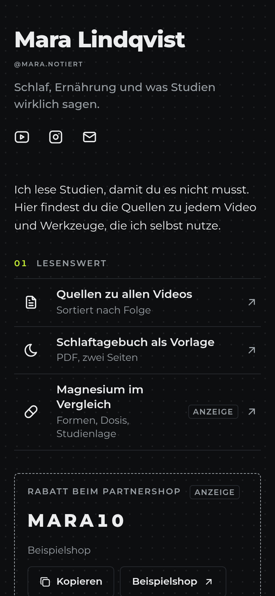
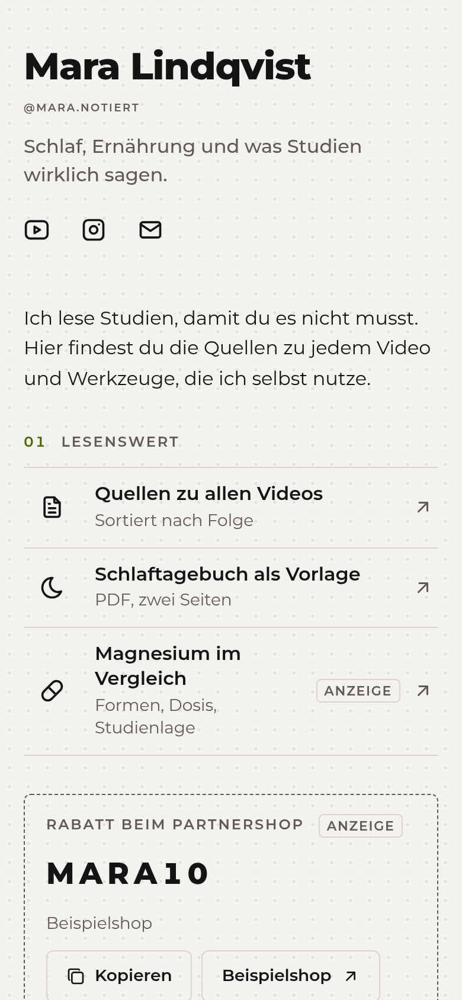
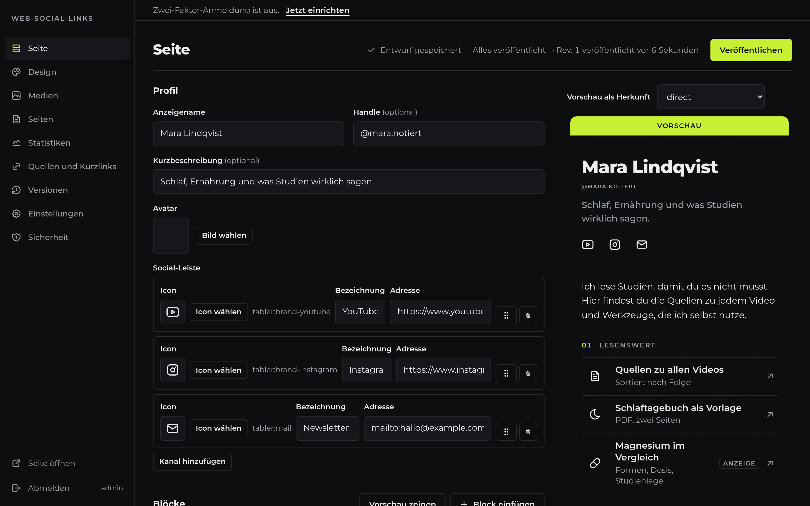

# web-social-links

A self-hosted link-in-bio page with an admin CMS, cookieless server-side analytics and a hardened login, shipped as one Node container with SQLite.

| Datasheet preset                                                                                   | Paper preset                                                                                     | Editor                                                                                 |
| -------------------------------------------------------------------------------------------------- | ------------------------------------------------------------------------------------------------ | -------------------------------------------------------------------------------------- |
|  |  |  |

The public page is plain server-rendered HTML and CSS: no framework JavaScript, no cookies, no requests to other origins, `noindex` everywhere. Content is edited as a draft in the admin and published as numbered revisions.

## Quick start

Requires Docker with Compose and OpenSSL on the host.

```sh
cp .env.example .env
./scripts/generate-secrets.sh
./scripts/init-data.sh
docker compose up -d
```

Set `PUBLIC_ORIGIN`, `SECURITY_CONTACT` and your own `INITIAL_ADMIN_PASSWORD` in `.env` first. The app listens on `127.0.0.1:3000` and refuses to start if a required value is missing or a key is weak; the log line names the variable.

Open `/admin`, log in with `admin` and the initial password (`admin123` if you left it empty) and follow the first login wizard: it forces a new password and offers a username and TOTP. Until the password is changed the log warns on every start. `pnpm seed:demo` (or `docker compose exec app node scripts/seed-demo.mjs`) fills the draft with example content. Publishing is refused until the Impressum and the privacy policy contain real text instead of the template placeholders.

## Configuration

| Variable                      | Default                    | Purpose                                                                                                               |
| ----------------------------- | -------------------------- | --------------------------------------------------------------------------------------------------------------------- |
| `PUBLIC_ORIGIN`               | required                   | Canonical origin, for example `https://links.example.com`                                                             |
| `ALIAS_ORIGINS`               | empty                      | Further origins that redirect with 301 to `PUBLIC_ORIGIN`, comma separated                                            |
| `ADMIN_ALLOWED_HOSTS`         | host of `PUBLIC_ORIGIN`    | Hosts that serve the admin                                                                                            |
| `ADMIN_IP_ALLOWLIST`          | empty, any address         | CIDR ranges allowed to reach the admin                                                                                |
| `TRUSTED_PROXIES`             | empty, socket address only | Proxies whose `X-Forwarded-For` entries are trusted. CIDR ranges plus the presets `private`, `loopback`, `cloudflare` |
| `PROXY_PEER_HEADER`           | empty                      | Header in which your proxy passes its real TCP peer, see Reverse proxy                                                |
| `APP_ENCRYPTION_KEY`          | required                   | 32 random bytes, base64. Encrypts TOTP secrets                                                                        |
| `APP_ENCRYPTION_KEY_PREVIOUS` | empty                      | Previous key during a rotation, only used for decryption                                                              |
| `ANALYTICS_HMAC_KEY`          | required                   | At least 32 random bytes, base64                                                                                      |
| `INITIAL_ADMIN_USERNAME`      | `admin`                    | Owner account created on first start                                                                                  |
| `INITIAL_ADMIN_PASSWORD`      | `admin123`                 | Must be changed at first login. Set your own value before the app is reachable                                        |
| `TOTP_ISSUER`                 | host of `PUBLIC_ORIGIN`    | Name shown in authenticator apps                                                                                      |
| `SESSION_IDLE_MINUTES`        | `60`                       | Admin session idle timeout                                                                                            |
| `SESSION_MAX_HOURS`           | `24`                       | Admin session absolute lifetime                                                                                       |
| `UPLOAD_MAX_MB`               | `10`                       | Upload limit per file                                                                                                 |
| `ANALYTICS_FLUSH_SECONDS`     | `5`                        | How often buffered analytics events are written                                                                       |
| `LOG_LEVEL`                   | `info`                     | `debug`, `info`, `warn` or `error`                                                                                    |
| `APP_PORT`                    | `3000`                     | Host port bound to `127.0.0.1`                                                                                        |
| `PROXY_NETWORK`               | `proxy`                    | External Docker network for `compose.proxy-network.example.yaml`                                                      |
| `TZ`                          | `Europe/Berlin`            | Time zone for days in statistics and schedules                                                                        |
| `BAN_SCOPE`                   | `admin`                    | `admin` blocks banned addresses from the admin only, `all` from everything                                            |
| `SECURITY_CONTACT`            | required                   | `mailto:` or `https:` address for `security.txt`                                                                      |

`generate-secrets.sh` fills empty keys and never overwrites existing values.

## Reverse proxy

### Nginx Proxy Manager and Cloudflare

If Nginx Proxy Manager runs in Docker, attach the app to its network instead of publishing a port:

```sh
docker compose -f compose.yaml -f compose.proxy-network.example.yaml up -d
```

`PROXY_NETWORK` is the name of the network Nginx Proxy Manager is in, for example `npm_default`.

Create one proxy host for the canonical domain and every alias domain, forwarding to `app` port `3000` (or `127.0.0.1:3000` when NPM runs on the host). The app performs the alias redirect itself. In the Advanced tab of each proxy host, add:

```nginx
location / {
  include conf.d/include/proxy.conf;
  proxy_set_header X-Proxy-Peer $realip_remote_addr;
}
```

and in `.env`:

```sh
TRUSTED_PROXIES=private,loopback,cloudflare
PROXY_PEER_HEADER=x-proxy-peer
```

Why: Nginx Proxy Manager trusts Cloudflare and CloudFront addresses and takes the client address from their `X-Real-IP` header. A visitor can send that header through Cloudflare and choose any address, which would defeat rate limits and bans. `$realip_remote_addr` is the address that actually connected to Nginx Proxy Manager, so the app can verify the chain itself. The custom `location /` replaces the default one of that proxy host; NPM access lists on it no longer apply, use `ADMIN_IP_ALLOWLIST` instead.

Only set `PROXY_PEER_HEADER` when the proxy really sets that header. Otherwise a client could send it.

In Cloudflare, keep the DNS records proxied, use SSL mode Full (strict) and do not add a cache rule for HTML.

## What it collects

Public pages set no cookies and do not touch storage on the device. Counting happens on the server:

| Data                                                                                                                                                                                                                                      | Where                          | Kept                                                                                                                          |
| ----------------------------------------------------------------------------------------------------------------------------------------------------------------------------------------------------------------------------------------- | ------------------------------ | ----------------------------------------------------------------------------------------------------------------------------- |
| Page view or link click: time, link, source (short link, `s`, `utm_source`, in-app browser or referrer host), referrer host only, UTM values, device type, browser and OS family, country from `CF-IPCountry` when Cloudflare reported it | `events` table                 | Raw rows for the configured retention (30 days by default, 1 to 365), daily totals afterwards                                 |
| Link preview fetches by messengers                                                                                                                                                                                                        | counted separately as previews | as above                                                                                                                      |
| Optional visitor estimate: `HMAC-SHA256(daily salt, IP + user agent + host)`, shortened                                                                                                                                                   | `events.visitor_hash`          | The salt is deleted at day end, so hashes cannot be linked across days or reversed. Not computed for `Sec-GPC: 1` or `DNT: 1` |
| Security events: failed logins, trap paths, bans with IP address                                                                                                                                                                          | `security_events` table        | 30 days                                                                                                                       |
| Admin session: IP and browser family                                                                                                                                                                                                      | `sessions` table               | until logout or expiry                                                                                                        |

Bots, `HEAD` requests, prefetches, error responses, signed in admins and the preview are never counted. IP addresses never reach the analytics tables. The reverse proxy writes its own access log; its retention is up to you. The privacy policy generator under Pages, Datenschutz writes a German template that matches the active configuration. Legal basis for analytics and security logging is legitimate interest (Art. 6(1)(f) GDPR); with no device access, section 25 TDDDG does not apply.

## Security

See [SECURITY.md](SECURITY.md) for the threat model, the measures and the known limits. In short: Argon2id with rate limits and lockouts, optional TOTP, `__Host-` session cookies with CSRF tokens, a hash based CSP without `unsafe-inline`, magic byte checks and full re-encoding of uploads, no open redirects, and a supply chain policy in pnpm and CI.

## Backup and restore

```sh
docker compose exec app node scripts/backup.mjs
```

writes `data/backups/backup-<time>/` with a consistent copy of the database (SQLite online backup) and the media files. Ship that directory off the host, for example with restic:

```sh
restic -r sftp:backup@example.com:/srv/restic backup ./data/backups --tag web-social-links
restic -r sftp:backup@example.com:/srv/restic forget --keep-daily 7 --keep-weekly 8 --prune
```

To restore, stop the app, restore the directory and run:

```sh
docker compose stop app
docker compose run --rm app node scripts/restore.mjs /data/backups/backup-<time>
docker compose start app
```

`restore.mjs` checks the database integrity before replacing anything. Test a restore after setting up backups and after every major upgrade: restore into a scratch directory with `DATA_DIR` pointing to it, start a second container on another port and compare the page.

## Updating

```sh
git pull
docker compose build --pull
docker compose up -d
```

Migrations run on start. Read [CHANGELOG.md](CHANGELOG.md) first and take a backup before major versions.

## Lost access

`docker compose exec app node scripts/reset-admin.mjs` turns off 2FA, ends all sessions and prints a one-time password.

## Accessibility

The public page and every admin view are tested with axe for WCAG 2.2 AA in CI. Lighthouse on mobile must report at least 95 for performance and 100 for accessibility and best practices. Reordering works with the keyboard (space, arrows, space, escape) and through menus; charts have a table view. The manual checklist is in [CONTRIBUTING.md](CONTRIBUTING.md).

## Development

Node 26.13.0 (see `.node-version`) and pnpm 11.

```sh
pnpm install
pnpm dev
```

| Command                 | Purpose                                                                                                      |
| ----------------------- | ------------------------------------------------------------------------------------------------------------ |
| `pnpm lint`             | ESLint, Prettier and the text rules                                                                          |
| `pnpm typecheck`        | vue-tsc over app, server, shared and tests                                                                   |
| `pnpm test`             | Unit tests                                                                                                   |
| `pnpm build`            | Icon index and production build                                                                              |
| `pnpm test:integration` | Starts the built server per file and tests the HTTP API                                                      |
| `pnpm test:e2e`         | Playwright with axe and Lighthouse against the built server; set `CHROMIUM_PATH` to use an installed browser |
| `pnpm notices`          | Regenerates the license list of the bundled packages                                                         |

Conventions are in [CONTRIBUTING.md](CONTRIBUTING.md).

## License

[MIT](LICENSE)
